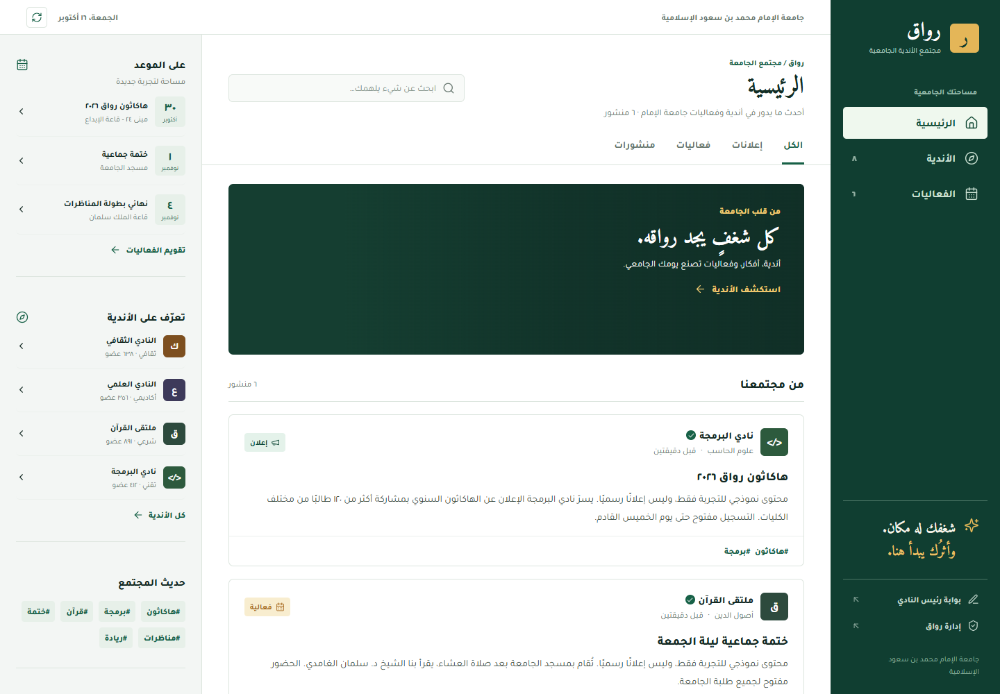
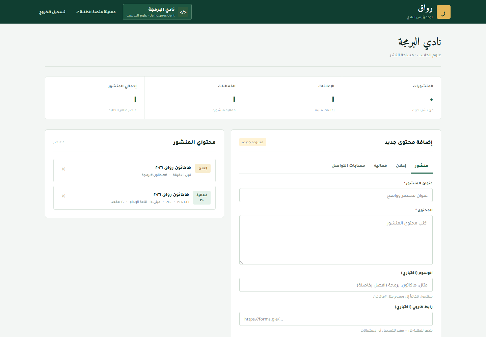
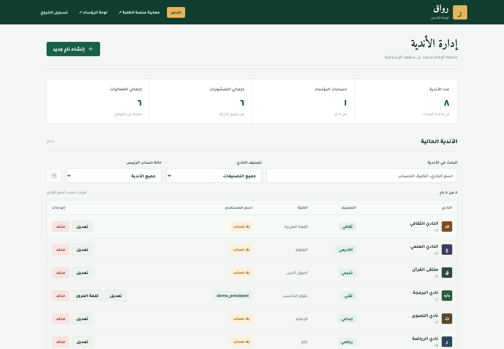

# رواق

منصة عربية لأندية الجامعة، تجمع أخبار الأندية وفعالياتها في واجهة طلابية،
مع بوابتين مستقلتين لرئيس النادي والأدمن. مشروع تجريبي، وليس خدمة رسمية للجامعة.

**[افتح رواق](https://opt-wide-animal-munich.trycloudflare.com/%D8%B1%D9%88%D8%A7%D9%82.html)**
| [تصفح الفعاليات](https://opt-wide-animal-munich.trycloudflare.com/%D8%B1%D9%88%D8%A7%D9%82.html#events)
| [دليل التركيب الكامل](riwaq/README.md)

## جرّب الموقع

هذه حسابات **تجريبية عامة ومقصودة للنشر**، في قاعدة بيانات وملفات رفع منفصلة
عن النسخة الأصلية. ليست كلمات مرور المالك أو بيانات اتصال MySQL.

| القسم | الرابط | اسم المستخدم | كلمة المرور |
| --- | --- | --- | --- |
| الطلاب | [واجهة الطلاب](https://opt-wide-animal-munich.trycloudflare.com/%D8%B1%D9%88%D8%A7%D9%82.html) | لا يحتاج حسابًا | لا يحتاج كلمة مرور |
| رئيس النادي | [لوحة الرئيس](https://opt-wide-animal-munich.trycloudflare.com/presidents/) | `demo_president` | `RiwaqDemo!Club2026` |
| الأدمن | [لوحة الأدمن](https://opt-wide-animal-munich.trycloudflare.com/admin/) | `demo_admin` | `RiwaqDemo!Admin2026` |

كلمات المرور حساسة لحالة الأحرف. حساب الرئيس التجريبي مرتبط بنادي البرمجة.

> النسخة مشتركة بين الزوار: يستطيع مستخدم الأدمن تعديل بيانات التجربة وحذفها
> وتغيير حسابات الرؤساء، لذلك قد تتغير النتائج أو يتعطل حساب الرئيس بعد تجربة
> أحد الزوار. لا تدخل معلومات شخصية أو محتوى سريًا، ولا تعِد استخدام هذه
> الكلمات في موقع حقيقي. لا توجد إعادة ضبط تلقائية.

> الرابط الحالي نفق Cloudflare **مؤقت** يعتمد على بقاء جهاز المطوّر والخادم
> قيد التشغيل، وقد يتغير بعد إعادة تشغيل النفق. عند توقفه، تبقى الصور أدناه
> متاحة ويمكن تشغيل المشروع محليًا.

## كيف تجرّبه؟

1. افتح واجهة الطلاب دون تسجيل دخول. تصفح الأندية، وابحث في المنشورات والفعاليات،
   وجرّب فلتر النادي وتبويبي الفعاليات القادمة والسابقة.
2. ادخل بوابة الرئيس بالحساب أعلاه. اكتب منشورًا، وأرفق صورة، ثم اضغط «معاينة»
   قبل النشر. التنقل بين تبويبات المحتوى يحافظ على المسودات داخل الصفحة فقط.
3. انشر المحتوى، ثم أعد تحميل صفحة الطلاب لمشاهدته. يستطيع الرئيس إدارة محتوى
   ناديه فقط؛ لا يملك إدارة الأندية أو حسابات الرؤساء.
4. ادخل بوابة الأدمن. جرّب البحث والتصنيف وفلتر وجود حساب للرئيس، أو أنشئ
   ناديًا تجريبيًا وحساب رئيس له. أي تعديل هنا يخص نسخة التجربة المشتركة.

يفضل استخدام ملف متصفح منفصل أو نافذة خاصة لكل دور عند تجربتهما معًا؛
الجلستان على النطاق نفسه، وتسجيل الدخول بدور آخر يغيّر جلسة ذلك المتصفح.

## صور الواجهات

لقطات فعلية من نسخة التجربة ببيانات نموذجية، وليست بيانات تشغيل حقيقية.

### الطلاب



### رئيس النادي



### الأدمن



## كيف يعمل؟

| الجزء | التقنية والوظيفة |
| --- | --- |
| واجهة الطلاب | React مع HTML وCSS، واتجاه عربي RTL |
| بوابتا الرئيس والأدمن | JavaScript وواجهتان مستقلتان |
| الخادم | PHP وREST API |
| البيانات | MySQL وعلاقات بين الأندية والحسابات والمحتوى |
| الصلاحيات | تحقق من الجلسة والدور وملكية النادي في الخادم، مع CSRF |

المسارات الثلاثة تبقى منفصلة: `رواق.html` و`presidents/` و`admin/`.
الفصل البصري وحده ليس وسيلة الحماية؛ الـAPI يرفض الطلبات غير المصرح بها.

## التشغيل على جهازك

تحتاج PHP 8+ مع `pdo_mysql` و`mbstring` و`fileinfo` و`openssl`، وقاعدة MySQL.
التحقق الحالي أُجري على MySQL 8 وMicrosoft Edge.

1. نزّل المستودع، ثم افتح الطرفية داخل مجلد `riwaq`.
2. أنشئ قاعدة بيانات فارغة ومستخدمًا لها، وانسخ `api/config.example.php`
   إلى `api/config.php`. أدخل إعدادات الاتصال المحلية في الملف الجديد.
3. شغّل التهيئة مرة واحدة على القاعدة الجديدة:

```sh
php api/setup.php
```

تُولّد التهيئة حسابات محلية بكلمات مرور عشوائية وتعرضها في المخرجات؛ احتفظ بها
بشكل خاص. **حسابات المعاينة المنشورة أعلى الصفحة ليست حسابات نسختك المحلية**.

4. شغّل الخادم من مجلد `riwaq`:

```sh
php -S 127.0.0.1:8000 -t . router.php
```

افتح [الطلاب محليًا](http://127.0.0.1:8000/)،
[الرؤساء محليًا](http://127.0.0.1:8000/presidents/)،
أو [الأدمن محليًا](http://127.0.0.1:8000/admin/).
تتوفر أيضًا ملفات التشغيل `start-dev.bat` لويندوز و`start-dev.sh` للأنظمة الأخرى.

لمعاينة التصميم فقط دون قاعدة بيانات، افتح `riwaq/رواق.html` مباشرة في المتصفح؛
تظهر بيانات نموذجية، ولا تعمل عمليات النشر أو الدخول إلى اللوحات بهذه الطريقة.

لا ترفع `api/config.php` أو `api/config.local.php` أو `.tools/` أو مخرجات التهيئة
أو نسخ قواعد البيانات إلى GitHub.

## الاختبارات والاستضافة

من جذر المستودع، مع Node.js وقاعدة MySQL محلية مهيأة للاختبار:

```sh
node riwaq/tests/integration.cjs
```

[تعليمات الاختبار](riwaq/tests/README.md) تشرح تشغيل تغطية المتصفح واستخدام
قاعدة اختبار مستقلة. آخر تحقق كامل للتطوير: **27 مجموعة ناجحة**.

رفع الكود على GitHub لا يشغّل PHP أو MySQL تلقائيًا. GitHub Pages مخصص للمواقع
الثابتة؛ تشغيل الأقسام الثلاثة بكامل وظائفها يحتاج استضافة تدعم PHP وMySQL.
راجع [توثيق GitHub Pages](https://docs.github.com/en/pages/getting-started-with-github-pages/what-is-github-pages)
و[دليل التركيب والاستضافة](riwaq/README.md).
